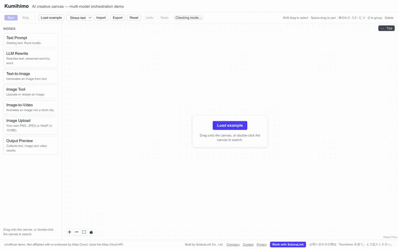
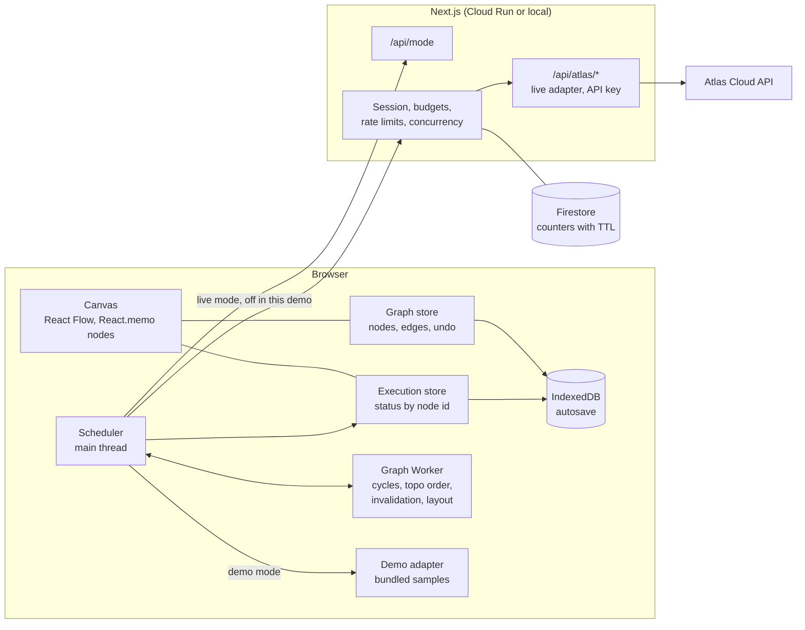
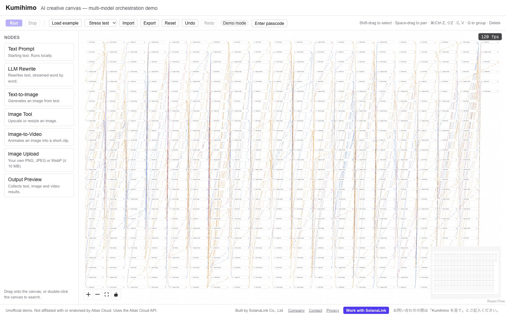

# Kumihimo

An AI creative canvas: connect prompts, language models, image and video models into a workflow, then run it as a graph. Built with Next.js and React Flow, designed for the Atlas Cloud API.

> **Unofficial demo. Not affiliated with or endorsed by Atlas Cloud.** Live mode is built on Atlas Cloud's public API and is switched off in this demo.

- **Runs on demo data:** every result is a pre-made original sample; no AI model is called, and prompts and images never leave the browser. Live mode (the real Atlas Cloud API through the server) is implemented and tested, and switched off.
- **Author:** Tony · © 2026 SolanaLink Co., Ltd. · MIT licence



<sub>Recorded in demo mode: results are pre-made samples, and the times on the nodes are demo delays, not model timings. The FPS counter is the page's own reading while recording (Chrome on a 120 Hz display); the GIF itself plays at 6 frames per second.</sub>

## What it does

- **Canvas:** drag nodes from the library or double-click to search; typed ports (text, image, video) refuse wrong or cyclic connections; box-select, copy/paste, group, undo/redo; autosaves to IndexedDB.
- **Seven node types:** Text Prompt, LLM Rewrite (streamed word by word), Text-to-Image, Image Tool (upscale, restyle), Image-to-Video, Image Upload, Output Preview.
- **Execution engine:** runs the graph in dependency order, in parallel where it can, caches results, and after an edit re-runs only what is out of date.
- **Two modes, one interface:** demo mode runs in the browser with bundled samples chosen to match the workflow; live mode (passcode, currently off) calls the real API through the server.
- **Workflow files:** export the graph and its parameters as JSON and import it again (results and URLs are never in the file).
- **Stress test:** generate 100, 250 or 500 nodes and watch the FPS counter.

This demo uses a curated subset of models; the registry is `src/atlas/models.ts`. The demo samples are original art drawn in code ([docs/demo-samples.md](docs/demo-samples.md)); each carries a "DEMO SAMPLE" mark, and the app labels them "Demo data" with "Sample output, not produced by this model" beside every model name.

## Architecture



- **The browser never talks to Atlas Cloud.** The key is read only in server modules; the browser calls this app's own routes.
- **Graph state and execution state are separate stores.** React Flow's `nodes` array holds only the document; status, progress and streamed text live in a store keyed by node id, so a running node re-renders only itself.
- **Heavy graph work runs in a Web Worker:** cycle detection, topological order, downstream invalidation, stress-graph generation and layout. The main thread renders.
- **Demo and live are two implementations of one adapter interface.** In demo mode the browser uses the mock adapter itself, so prompts and images never leave the page and the server only reports the mode. `LIVE_MODE=off` closes live mode for everyone without a rebuild.

More detail: [docs/architecture.en.md](docs/architecture.en.md).

## Execution engine

The rules are pure functions (`src/engine/run.ts`); the scheduler (`src/client/scheduler.ts`) owns timers, requests and stores.

| From | To | When |
|---|---|---|
| idle | queued | included in a run |
| queued | running | every input succeeded and a slot is free |
| running | succeeded | a result arrived (cache hits included) |
| running | failed | upstream error, timeout or cancel |
| failed | queued | retry |
| succeeded | stale | its parameters or an input changed |
| stale | queued | run again |

- **Order and concurrency:** nodes start in topological order as soon as their inputs are ready, at most three paid requests at a time. Local nodes (text, preview) finish in the same pass.
- **Caching:** a node's cache key is the stable JSON of its kind, parameters and input values. Running an unchanged graph sends nothing.
- **Invalidation:** editing a node marks it and everything downstream stale. "Run from here" re-runs only the stale branch, so editing one of three shot prompts re-runs one video.
- **Wrap-up:** when an upstream node fails, queued nodes below it return to their previous state instead of waiting forever.
- **Long jobs:** image and video jobs are submitted, then polled with timeouts and cancellation. Prediction ids are saved to IndexedDB immediately, so a reload resumes polling instead of submitting again.
- **Uploads:** an uploaded image, and anything made from it, is only sent to models confirmed to run on Atlas Cloud itself. The browser checks this and the server enforces it.

## Live mode safeguards (implemented, switched off in this demo)

- Passcode sessions in an HttpOnly signed cookie; passcodes are stored only as hashes, each with an expiry and a daily budget.
- Each request reserves its upper-bound cost against the passcode's and the site's daily budget, together with a global concurrency slot, in one Firestore transaction.
- Rate limits count salted hashes of client addresses; raw IP addresses, prompts and images are never logged.
- A live run takes at most eight paid steps; stress-test graphs never run.
- Counters expire through Firestore TTL policies. (`/privacy` describes the demo as it runs now; the live-mode notice, with retention periods, is kept in `src/i18n/privacy.ts`.)

## Performance

Techniques:

- **Viewport culling:** React Flow's `onlyRenderVisibleElements`; zoomed in on 500 nodes, the DOM holds only the visible ones.
- **Few re-renders:** every node component is `React.memo`, `nodeTypes` is defined once at module level, and nodes subscribe only to their own execution entry. Over five seconds of LLM streaming, the other ten nodes of the example render zero times (`e2e/render-isolation.spec.ts`).
- **Streamed text** is flushed at most once per animation frame.
- **Level of detail:** below zoom 0.5 a node shows only its title and status dot. Crossing the threshold is rendered as a React transition, in slices.
- **Worker:** generating and laying out 500 nodes happens off the main thread; the nodes then stream in 50 per frame after the view is fitted to their final bounds.
- **Lazy media:** thumbnails with `loading="lazy"` and `decoding="async"`; videos show a poster on the canvas and play in the side panel.

Measured with `pnpm perf`: 500 nodes and 600 connections, all on screen at fit (zoom 0.21); 10 seconds each of panning, zooming and dragging one node; frame times from `requestAnimationFrame`, long tasks from `PerformanceObserver`. Production build, Google Chrome 155 in a visible window, MacBook Pro (Apple M4 Max) built-in display (120 Hz), 1440 × 900 at pixel ratio 2.

| | Pan | Zoom | Drag one node | Generate and load 500 nodes |
|---|---|---|---|---|
| This machine | 120.0 fps · p95 9.1 ms | 119.6 fps · p95 9.1 ms | 119.7 fps · p95 9.1 ms | 219 ms, no task over 50 ms |
| CPU slowed 4× | 81.9 fps · p95 25.5 ms | 95.9 fps · p95 17.6 ms | 77.5 fps · p95 25.8 ms | 981 ms, 8 tasks of 52–80 ms |

The second row slows only the renderer's CPU (Chrome DevTools throttling, not the GPU) as a rough stand-in for an ordinary laptop. With that slowdown, panning showed 2 and zooming 7 tasks of 50–72 ms. Raw numbers: [`docs/perf/`](docs/perf). The numbers depend on the machine and display; the counter in the top-right corner of the live demo shows yours.



## Run it locally

Requirements: Node.js 24 (`.nvmrc`) and pnpm.

```bash
pnpm install
pnpm dev        # http://127.0.0.1:3070
```

Without `ATLASCLOUD_API_KEY` the app starts in demo mode: everything works with sample results and nothing is sent to Atlas Cloud. For live mode, copy `.env.example` to `.env.local` and fill it in (never commit it).

For an offline presentation on a laptop, run the production build in demo mode on `http://127.0.0.1:3080` (live mode forced off; no network needed once the page is loaded):

```bash
scripts/demo-local.sh
```

## Tests

```bash
pnpm lint
pnpm typecheck
pnpm test       # Vitest: engine, scheduler, stores, server routes and guards
pnpm e2e        # Playwright on the production build, demo mode only
pnpm perf       # the performance numbers above, in a visible Chrome window
```

## Extension points

- **A new node type (for example audio):** add the kind and its typed ports in `src/engine/nodes.ts` (a new `audio` port type), its models in `src/atlas/models.ts`, a method on the adapter interface with live and mock implementations in `src/atlas/`, a runner in `src/client/runners.ts`, and a component in `src/canvas/nodes/`. Connection rules, scheduling, caching and invalidation need no changes.
- **Webhooks instead of polling:** add a route under `src/app/api/atlas/` that verifies the callback and records the result against the stored prediction, then let the scheduler take results from either source. Keep polling as the fallback.

## Licence

MIT © 2026 SolanaLink Co., Ltd. See [LICENSE](LICENSE). Model names appear only as technical identifiers; all trademarks belong to their owners.
